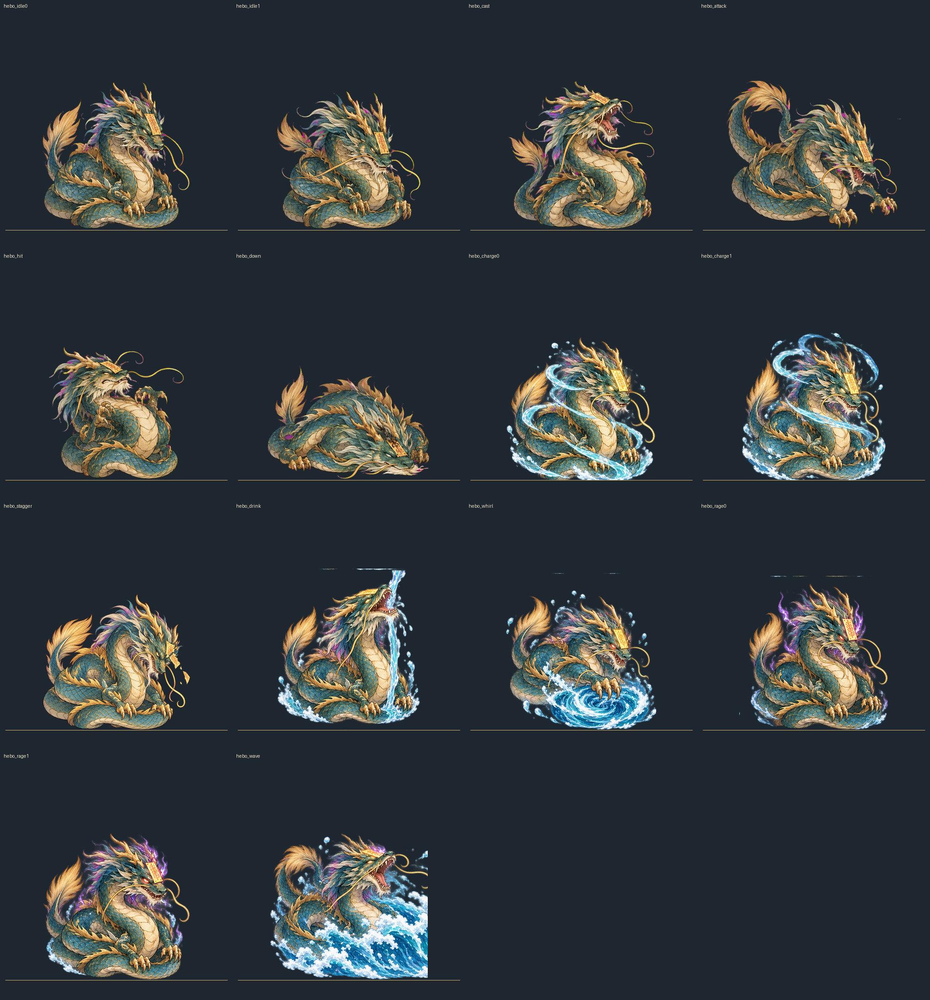

# 河伯戰鬥新姿勢與漩渦特效

本組素材只新增圖片與 `src/assets.js` 登記，不接戰鬥邏輯。來源基準是專案既有 `assets/img/hebo_idle0.webp` 等河伯姿勢；人物維持青綠盤龍、淺色腹甲、金色鬃角與額頭控妖符，朝右下的 3/4 斜視。

## 成品

| 檔案 | 用途 | 規格與錨點 | 檢查 |
|---|---|---|---|
| `assets/img/hebo_charge0.webp`、`hebo_charge1.webp` | 濁浪蓄力循環 | 512×512 RGBA，腳底 y=476 | 水流與光暈位置不同；角色輪廓尺寸符合舊圖 |
| `assets/img/hebo_stagger.webp` | 失衡 | 512×512 RGBA，腳底 y=476 | 低頭失衡，符紙裂開並有碎片脫落 |
| `assets/img/hebo_drink.webp` | 吞水回復 | 512×512 RGBA，腳底 y=476 | 抬頭承接水柱 |
| `assets/img/hebo_whirl.webp` | 前爪橫掃與漩渦 | 512×512 RGBA，腳底 y=476 | 前爪及腳下漩渦清楚可辨 |
| `assets/img/hebo_rage0.webp`、`hebo_rage1.webp` | 第二階段待機循環 | 512×512 RGBA，腳底 y=476 | 赤紅眼光、紫色符光；兩格姿勢有細微差異 |
| `assets/img/hebo_wave.webp` | 濁浪釋放 | 512×512 RGBA，腳底 y=476 | 河伯怒吼並向前釋出浪潮，內容留在畫布內 |
| `assets/img/fx_whirl.webp` | 可疊在角色腳下的漩渦特效 | 512×512 RGBA，漩渦重心偏下 | 無角色；透明區與可見特效分離 |

`contact.png` 將舊六張與新八張河伯姿勢以相同 512×512 畫布和 y=476 基線排列。漩渦特效另看 `assets/img/fx_whirl.webp`。原始生成圖保留為 `hebo_pose_sheet_original.png`、`hebo_stagger_original.png`、`fx_whirl_original.png`。

## 提示詞

姿勢總表使用一次生成的 3×3 圖集，按由左至右、由上至下裁出前八格；第九格未使用。提交給圖像模型的要求如下：

> Create one 3-by-3 contact sheet of nine separate 512x512 transparent game-sprite cells, with consistent padding and no grid lines. Use the same Hebo in every used cell: a coiled Chinese river dragon facing lower right, teal-green scales, pale segmented belly, golden horns and mane, and a yellow exorcism talisman on the forehead. Watercolor hand-painted texture, delicate ink outlines, dramatic but readable silhouettes. Cell 1 charge frame A: body rises slightly, spiral river water curls upward around the body, scales and talisman glow softly. Cell 2 charge frame B: same pose and scale, water spiral and glow shift for a seamless two-frame loop. Cell 3 stagger: head lowered, body wobbling, eyes unfocused, talisman cracked and falling away. Cell 4 drink: head lifted, a narrow stream of water flows upward from below into the open mouth as if restoring power. Cell 5 whirl: one front claw sweeps forward and a compact whirlpool forms beneath it. Cell 6 rage idle A: same Hebo, tense coiled body, faint red eyes and vivid talisman with a subtle purple aura. Cell 7 rage idle B: same scale and anchor as cell 6, slight breathing variation, red eyes and purple talisman glow. Cell 8 wave release: roar with body leaned back and a large forward surge of water fully contained inside the cell. Cell 9 left empty and transparent. Keep each full character centered with the bottom of the coiled body at the same baseline; no text, props, borders or ground plane. True transparent RGBA background.

失衡姿勢以舊圖為參照另生成一版，替換圖集中的失衡格；模型指令：

> Create a single game sprite pose of this exact Hebo character, preserving its coiled dragon body, teal-green scales, pale segmented belly, golden mane and horns, yellow exorcism talisman, watercolor hand-painted style and fine ink outlines. Pose: staggered and dazed after losing balance, head bowed low, body subtly swaying, eyes unfocused and dim; the yellow talisman is clearly cracked and visibly slipping off his forehead, with a small torn piece falling beside the head. Make the broken talisman unmistakable. Keep the character facing toward the lower right. Match the reference's visible size, centered horizontal placement, and bottom foot/body anchor; leave enough breathing room around every part. No extra water, no motion blur, no ground, no shadows, no environment, no text. True transparent RGBA background, not a checkerboard or colored background.

漩渦單圖提示詞：

> Create a standalone transparent 512x512 game VFX sprite: an oblique, slightly top-down river whirlpool, blue-gray and aqua water spiraling into a dark teal center positioned below the canvas midpoint. Painterly watercolor with delicate ink accents and restrained white foam. Keep the whole effect inside the canvas with soft irregular edges and ample transparent space around it. No character, no ground, no shadow, no text, no border. True transparent RGBA background.

以上英文提示詞為本組素材的製作提示詞紀錄。圖像由 OpenAI 內建 image_gen 原創生成，未使用既有作品人物或外部圖像拼貼。

## 處理方式

- 圖集原始 PNG 為 1254×1254 RGBA，切成 3×3 等大格；使用前八格。角色格先將 alpha ≤8 的像素設為透明，再以 Lanczos 縮放，按可見範圍置中至 x=256、底部對齊 y=476。
- `hebo_stagger_original.png` 為替換版失衡圖，保留 RGBA，依可見範圍裁切，縮放到和 `hebo_idle0.webp` 相同可見寬度，再置中、對齊同一底線。
- `fx_whirl_original.png` 依 alpha 可見範圍裁切，等比縮至 430px 寬，置於 512×512 畫布偏下位置。
- 全部遊戲圖輸出為 lossless WebP。沒有色鍵去背；每張輸出均保留透明 alpha。量測使用 alpha > 8 的可見像素：角色可見寬度為舊 `hebo_idle0` 的 0.8–1.25 倍，中心在 x=256±20，底線在 y=476±6。細節由 `tests/hebo-poses.mjs` 自動檢查。
- `process_assets.py` 可由留存原圖重建九張成品及 `contact.png`。

## 對照圖

