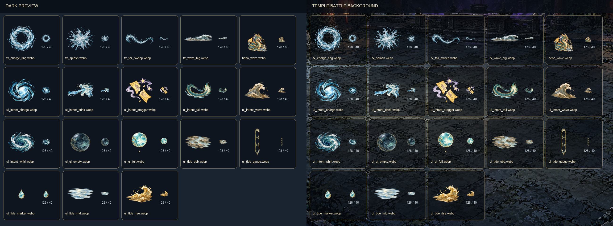

# 河伯戰 UI 與水系特效素材

本資料夾包含 18 張獨立的 lossless WebP 遊戲素材、檢視接觸表和驗證腳本。圖像以原創生成方式製作，沿用第一章夜藍、灰青、克制金色的色調及水彩淡墨線條。

## 素材清單

| 檔案 | 尺寸 | 用途 |
|---|---:|---|
| ui_intent_tail.webp | 128×128 | 龍尾橫掃預告 |
| ui_intent_charge.webp | 128×128 | 蓄力預告 |
| ui_intent_wave.webp | 128×128 | 濁浪預告 |
| ui_intent_stagger.webp | 128×128 | 失衡預告 |
| ui_intent_drink.webp | 128×128 | 吞水預告 |
| ui_intent_whirl.webp | 128×128 | 漩渦預告 |
| ui_tide_ebb.webp | 128×128 | 退潮 |
| ui_tide_mid.webp | 128×128 | 平潮 |
| ui_tide_rise.webp | 128×128 | 漲潮 |
| ui_qi_empty.webp | 96×96 | 暗淡渡氣珠 |
| ui_qi_full.webp | 96×96 | 發光渡氣珠 |
| ui_tide_gauge.webp | 64×320 | 三段式水位條外框 |
| ui_tide_marker.webp | 48×48 | 水位標記 |
| fx_tail_sweep.webp | 768×384 | 龍尾弧形水鞭 |
| fx_wave_big.webp | 1536×512 | 橫向濁浪特效 |
| fx_splash.webp | 512×512 | 水花爆開 |
| fx_charge_ring.webp | 512×512 | 蓄力水環 |
| hebo_wave.webp | 512×512 | 河伯釋放濁浪姿勢，取代同名舊圖 |

## 提示詞與來源

來源：OpenAI 內建圖像生成。透明背景使用原生 RGBA。下列為實際使用的提示詞；河伯姿勢第一次生成因濁浪太寬而棄用，以下列的是重新生成的最終提示詞。

### 九張戰鬥／潮汐圖示（3×3 接觸表）

> Create a clean 3-by-3 contact sheet of exactly nine separate, self-contained Chinese fantasy RPG battle UI ICONS, each occupying one equal square cell with generous blank transparent gutters between cells, no cell borders, no labels, no typography, no badges or frames. Overall style: hand-painted watercolor with fine pale ink outlines, subtle gold accents, readable silhouettes at 40px, soft natural forms, transparent RGBA background. Keep each icon entirely within its own square and leave at least 12% transparent margin on all sides. In reading order: 1) dragon tail sweeping in a curved horizontal arc, teal and gold; 2) water spiraling inward to gather into a glowing ball, cool blue-teal; 3) a single rising muddy river wave crest, muted silt-brown and blue-gray; 4) cracked yellow talisman with two small floating dizziness stars, gold and pale violet; 5) clear narrow water stream flowing into an open dragon mouth silhouette, blue-white; 6) oblique top-down compact whirlpool, deep teal and silver foam; 7) ebb tide with exposed riverbed stones and lowered pale blue water; 8) calm mid-tide flat water in white-gray; 9) rising tide with an upward curling small wave in muted amber-gold. No scenery or background, no shadows, no checkerboard. Each cell is one separate icon artwork and not connected to neighboring cells.

### 渡氣珠、水位標記、水位條（2×2 接觸表）

> Create a 2-by-2 sheet of four distinct Chinese fantasy RPG tide HUD assets, each in its own equal 768x768 square cell with broad transparent gutters, no borders, no labels. Watercolor hand-painted ink lines, restrained gold engraving, palette of night-blue and gray-teal, clean transparent alpha. Each object fully inside its cell with generous empty margin; cells are independent and must not touch. Top left: one 96x96-design-size water pearl icon, dimmed translucent dark blue-teal, for empty qi. Top right: matching same-size water pearl, bright luminous jade-gold and cyan, for full qi. Bottom left: isolated 48x48-design-size pale jade water-drop marker with subtle gold edge, centered. Bottom right: a tall narrow 64x320-design-size vertical tide gauge frame with three empty compartments stacked vertically (top rise, middle calm, bottom ebb), delicate antique gold edging, interior truly transparent and empty for programmatic color fill. No background, no shadow, no checkerboard, no extra ornaments outside the listed objects.

### 四張水系戰鬥特效（2×2 接觸表）

> Create a 2-by-2 contact sheet of exactly four distinct isolated battle water VFX illustrations, one centered in each equal square cell with generous blank transparent gutters, no borders, no labels, nothing touching between cells. Original watercolor hand-painted style with delicate ink contouring, cool blue-gray and gray-teal water with white foam, muted silt ochre only where called for. True transparent RGBA background, no checkerboard, no ground, no character, no text. Top-left cell: a long horizontal dragon-tail water whip, sweeping left to right in a graceful arc with droplets trailing, composed to fit a 2:1 landscape frame and entirely visible. Top-right cell: one full-width long muddy teal-brown storm wave, pushing from left to right, curling crest foam, complete rounded leading edge and complete trailing edge visible with clear transparent margin on all sides, composed to fit 3:1 landscape frame. Bottom-left cell: one compact splash burst radiating from center to all sides, no hard cropped edges. Bottom-right cell: a complete circular inward-contracting water ring with a few fine streams of light, for wrapping around a dragon, no hard cropped edges. Every effect fits within its cell; leave at least 12% margin.

### 河伯濁浪姿勢（最終重生版本）

> Redraw the reference river dragon as one compact game sprite for a 512x512 canvas. Preserve the exact same teal coiled dragon anatomy, golden mane/horns, yellow forehead talisman, right-down facing three-quarter angle, and watercolor with fine pale ink outlines. Match the reference sprite's silhouette scale: dragon visible body occupies about 320 pixels wide and 320 pixels tall, centered at x=256, with the bottom coil touching y=476. Action pose: head lifted and roaring, neck arched back. A SMALL contained muddy blue-gray and muted-ochre cresting wave appears immediately in front of the forward claws, attached to the dragon's lower-right silhouette; the wave extends no more than 40 pixels beyond the dragon body on the right and does not form a long horizontal banner. Keep the full dragon plus the compact wave entirely inside the 512 square; visible total width 300-355 pixels, no clipping, transparent margin left and right. The wave occupies at most the bottom-right quarter of the subject. Strongly prioritize the character being the same visual size as the reference, not a wide scene. Transparent RGBA, no background, no ground, no cast shadow, no detached particles, no text.

## 處理方式與品質檢查

- 接觸表按各自格子切開；淡霧背景的 alpha 小於 12 的像素清為透明，河伯邊緣小於 14 的像素清為透明。
- 以 8 向連通區檢查 alpha；每張成品移除面積小於 30 像素的孤立區塊，再以 LANCZOS 縮放並置中。WebP 使用 lossless 編碼。
- fx_wave_big.webp 原始浪形比例較窄，為符合全螢幕橫向特效的 1536×512 規格，最後將可見浪形橫向延展至 1450×470，垂直比例不變。這是本批最明顯的手動處理。
- hebo_wave.webp 以 hebo_idle0.webp 的 alpha 邊界為對齊基準：可見寬度 329px（與舊待機圖相同），中心 x=255.5，底線 y=476。最終新圖可見框為 x=91–420、y=164–476；舊待機圖為 x=91–420、y=148–476。
- contact.png 同時展示深色底和 bg_temple_v26.webp 戰鬥背景上的所有成品；UI 圖示以 128px 和 40px 兩種預覽檢查辨識度。
- hebo-ui-fx.mjs 以 Python Pillow、NumPy、SciPy 檢查 WebP 尺寸、透明 alpha、連通碎片、特效邊界留白和河伯姿勢對齊；姿勢基準使用舊圖 hebo_idle0.webp 的已量測邊界 x=91–420、y=148–476。

## 接觸表

